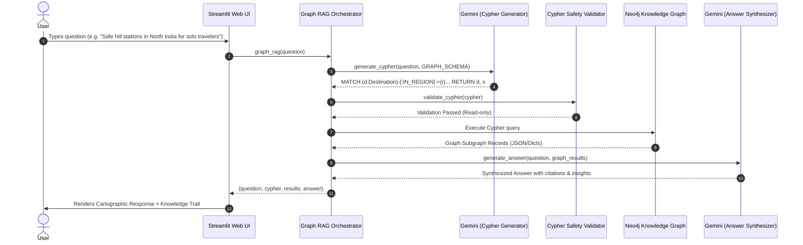

# 🏛️ Bharat Atlas — Technical Architecture & Graph RAG Deep Dive

This document provides a technical deep-dive into the design, data modeling, algorithm choices, and engineering decisions behind the **Bharat Atlas (India Tourism Graph RAG)** system.

---

## 📑 Contents
1. [Core Motivation & Problem Statement](#1-core-motivation--problem-statement)
2. [Graph RAG vs. Vector RAG vs. SQL: Architectural Comparison](#2-graph-rag-vs-vector-rag-vs-sql)
3. [Knowledge Graph Ontology & Data Modeling](#3-knowledge-graph-ontology--data-modeling)
4. [End-to-End Execution Lifecycle](#4-end-to-end-execution-lifecycle)
5. [Natural Language to Cypher Translation](#5-natural-language-to-cypher-translation)
6. [Security & Validation Layer](#6-security--validation-layer)
7. [Graph Retrieval & Context Assembly](#7-graph-retrieval--context-assembly)
8. [Answer Synthesis & Grounding](#8-answer-synthesis--grounding)
9. [Frontend Design & Cartographic UX Rationale](#9-frontend-design--cartographic-ux-rationale)

---

## 1. Core Motivation & Problem Statement

Travel decision-making is inherently **multi-dimensional** and **relational**. When planning travel, queries are rarely simple key-value lookups; they involve intersecting multiple constraints across different categories:

$$\text{Query} = \text{Location} \cap \text{Weather/Season} \cap \text{Safety} \cap \text{Activity} \cap \text{Traveler Demographic}$$

### The Failure Mode of Unstructured LLMs and Vector Search
1. **Unstructured Vector RAG**:
   - Converts tourism texts into vector embeddings (e.g. 1536-dimensional float vectors).
   - Uses Cosine Similarity: $\cos(\theta) = \frac{\mathbf{u} \cdot \mathbf{v}}{\|\mathbf{u}\| \|\mathbf{v}\|}$.
   - **Problem**: Similarity search identifies *semantically similar words*, but cannot enforce exact discrete logical filters like `Destination.safety_rating >= 4.5 AND Season = 'Winter' AND State = 'Himachal Pradesh'`.
2. **Standard LLM Hallucinations**:
   - Standard LLMs generate plausible-sounding combinations that may not exist in reality (e.g., suggesting a scuba diving spot in a landlocked mountain state or recommending a high-altitude trek during extreme monsoon risk).

**Solution**: Model tourism data as an explicit **Knowledge Graph (KG)** in Neo4j, where entities are nodes and constraints are traversable directed edges.

---

## 2. Graph RAG vs. Vector RAG vs. SQL

```
+-----------------------------------------------------------------------------------------+
|                                    QUERY TAXONOMY                                       |
+------------------------------------+----------------------------------------------------+
|  Query Type                        |  Best Architecture                                |
+------------------------------------+----------------------------------------------------+
|  "Tell me a story about Goa"       |  Standard Vector RAG (Unstructured text retrieval) |
|  "Count total destinations in Goa" |  SQL / Relational RAG (Tabular aggregation)        |
|  "Find safe hill stations in North |  Graph RAG (Multi-hop relationship traversal)      |
|   India good for solo trekking in  |                                                    |
|   winter with high safety ratings" |                                                    |
+------------------------------------+----------------------------------------------------+
```

### Detailed Comparison

| Evaluation Metric | Vector RAG (Embeddings) | SQL / Relational RAG | Graph RAG (Bharat Atlas) |
| :--- | :--- | :--- | :--- |
| **Data Representation** | Dense vector vectors in high-dimensional space | Flat tables with foreign key relationships | Labeled Property Graph (Nodes + Properties + Directed Edges) |
| **Multi-Hop Traversal** | ❌ Fails to link multi-entity chains | ⚠️ Requires expensive multi-table `JOIN` operations | 🌟 Native index-free adjacency traversal |
| **Constraint Precision** | ❌ Fuzzy similarity (High noise) | ✅ Exact relational filtering | 🌟 Exact discrete matching on structured entities |
| **Schema Flexibility** | High (any text can be chunked) | Low (rigid schema, expensive migrations) | 🌟 High (new node types/edges added without migration) |
| **Explainability** | ⚠️ Opaque vector distance score | ✅ Inspectable SQL statement | 🌟 Visual Knowledge Trail + Executable Cypher query |

---

## 3. Knowledge Graph Ontology & Data Modeling

The knowledge graph is modeled in Neo4j using the **Labeled Property Graph (LPG)** paradigm.

```mermaid
graph LR
    D[Destination] -->|IN_STATE| S[State]
    D -->|IN_DISTRICT| Dist[District]
    D -->|IN_REGION| R[Region]
    D -->|HAS_ACTIVITY| A[Activity]
    D -->|HAS_ATTRACTION| Attr[Attraction]
    D -->|HAS_TRIP_TYPE| TT[TripType]
    D -->|SUITABLE_FOR| Trav[TravelerType]
    D -->|HAS_CUISINE| C[Cuisine]
    D -->|BEST_IN| BSea[Season (Best)]
    D -->|AVOID_IN| ASea[Season (Avoid)]
```

### 1. Node Schema & Properties

#### `Destination` (Core Central Entity)
- `id` (String, Unique Primary Identifier)
- `destination_name` (String, e.g., "Manali", "Munnar", "Hampi")
- `altitude_m` (Integer)
- `popularity_score` (Float, 0.0 - 5.0)
- `safety_rating` (Float, 0.0 - 5.0)
- `minimum_days` / `ideal_days` / `maximum_days` (Integers)
- `permits_required` (Boolean) & `permits_details` (String)
- `accessibility`, `road_connectivity`, `mobile_network`, `internet_connectivity`, `atm_availability` (Strings)
- `food_scene`, `local_culture`, `local_customs` (Strings)
- `safety_notes`, `sustainability_notes` (Strings)
- `latitude`, `longitude` (Floats)
- `winter_temperature`, `summer_temperature`, `monsoon_temperature` (Strings)
- `nearest_airport_name`, `nearest_airport_distance_km`
- `nearest_railway_station_name`, `nearest_railway_station_distance_km`

#### Connected Dimension Nodes (Text stored in `.name`)
- `State`: e.g., `{name: "Himachal Pradesh"}`
- `District`: e.g., `{name: "Kullu"}`
- `Region`: e.g., `{name: "North India"}`
- `Activity`: e.g., `{name: "Trekking"}`, `{name: "River Rafting"}`
- `Attraction`: e.g., `{name: "Solang Valley"}`, `{name: "Rohtang Pass"}`
- `TripType`: e.g., `{name: "Adventure"}`, `{name: "Honeymoon"}`
- `TravelerType`: e.g., `{name: "Solo Travelers"}`, `{name: "Families"}`
- `Cuisine`: e.g., `{name: "Siddu"}`, `{name: "Trout Fish"}`
- `Season`: e.g., `{name: "Winter"}`, `{name: "Summer"}`, `{name: "Monsoon"}`

---

## 4. End-to-End Execution Lifecycle



---

## 5. Natural Language to Cypher Translation

The translation engine (`src/cypher_generator.py`) uses a schema-constrained system prompt that guides Google Gemini to generate precise, performant Cypher.

### Optimization Principles:
1. **Exact Schema Injection**: Every node label, property name, and relationship type is strictly defined.
2. **Case-Insensitive String Matching**: Ensures resilience against user query variations using `toLower(...) CONTAINS` or `=`.
3. **Structured Projections**: Queries project clean aliases (`d.destination_name AS destination`, `s.name AS state`).
4. **Model Resilience & Fallback**:
   - Primary: `gemini-3.5-flash-lite`
   - Fallback 1: `gemini-3.8-flash`
   - Fallback 2: `gemini-3.5-flash`
   - Fallback 3: `gemini-3.1-flash-lite`

### Example Translation:
**User Input**:
> *"Find top rated winter destinations in Uttarakhand suitable for adventure with high safety ratings."*

**Generated Cypher**:
```cypher
MATCH (d:Destination)-[:IN_STATE]->(s:State)
MATCH (d)-[:BEST_IN]->(season:Season)
MATCH (d)-[:HAS_TRIP_TYPE]->(t:TripType)
WHERE toLower(s.name) CONTAINS "uttarakhand"
  AND toLower(season.name) CONTAINS "winter"
  AND toLower(t.name) CONTAINS "adventure"
  AND d.safety_rating >= 4.0
RETURN d.destination_name AS destination,
       s.name AS state,
       d.safety_rating AS safety_rating,
       d.popularity_score AS popularity_score,
       d.ideal_days AS ideal_days,
       d.altitude_m AS altitude_m
ORDER BY d.popularity_score DESC
LIMIT 5
```

---

## 6. Security & Validation Layer

To prevent prompt injection, data mutation, or arbitrary Cypher execution, every query passes through a strict deterministic validator (`src/cypher_validator.py`):

```python
FORBIDDEN_KEYWORDS = [
    "CREATE", "MERGE", "DELETE", "DETACH DELETE",
    "SET", "REMOVE", "DROP", "ALTER", "GRANT"
]
```

If any write keyword is detected, an exception is immediately thrown, preventing unauthorized database alterations.

---

## 7. Graph Retrieval & Context Assembly

The retrieval engine (`src/graph_retriever.py`) executes the validated query against Neo4j and converts the record stream into sanitized Python dictionaries:
- Null values are gracefully handled.
- Nested relationship arrays are flattened for optimal token compression before feeding into the LLM context window.

---

## 8. Answer Synthesis & Grounding

The synthesis engine (`src/answer_generator.py`) receives the original question and the retrieved graph data.

### Grounding Rules:
1. **Zero Extrapolation**: Base all recommendations strictly on facts present in the retrieved records.
2. **Travel Guidance**: Highlight duration (`ideal_days`), safety rating, best season, altitude, and connectivity.
3. **Transparent Empty States**: If the knowledge graph returns no matching records for a specific query combination, explicitly notify the user rather than fabricating plausible destinations.

---

## 9. Frontend Design & Cartographic UX Rationale

The user interface (`app.py`) was intentionally engineered to depart from generic AI chatbot templates.

### Key Visual & Functional Elements:
- **Warm Cartographic Color Palette**: Desert amber (`#E07A5F`), deep indigo (`#1D2D44`), parchment warm sand (`#F4F1DE`), and sage accents (`#81B29A`).
- **Interactive Knowledge Trail**: Instead of hiding the backend graph or printing raw code blocks, the UI renders the exact traversal path (e.g., `Destination` $\rightarrow$ `IN_STATE` $\rightarrow$ `State` $\rightarrow$ `BEST_IN` $\rightarrow$ `Season`).
- **3-Zone Layout**:
  1. *Navigation Rail*: Quick query archetypes, system status, and filter presets.
  2. *Atlas Exploration Zone*: Inquiry input, synthesis narrative, and destination cards.
  3. *Graph Intelligence Inspector*: Transparent Cypher query review and raw subgraph payload inspectability.
