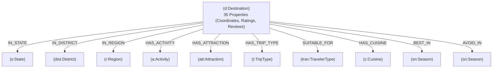

# 🗺️ Bharat Atlas — Comprehensive Project Guide & Technical Dossier

A complete end-to-end technical overview of the **Bharat Atlas (India Tourism Graph RAG)** system: covering dataset architecture, property graph design, LLM orchestration, engineering implementation, challenges overcome, and future roadmap.

---

## 📑 Table of Contents
1. [Executive Summary & Core Concept](#1-executive-summary--core-concept)
2. [Dataset Breakdown & Structure](#2-dataset-breakdown--structure)
3. [Database Architecture & Property Graph Design](#3-database-architecture--property-graph-design)
4. [Live Graph Metrics & Schema Specification](#4-live-graph-metrics--schema-specification)
5. [Model Stack & Dual-LLM Pipeline](#5-model-stack--dual-llm-pipeline)
6. [How It Was Built (Step-by-Step Implementation)](#6-how-it-was-built-step-by-step-implementation)
7. [How the Property Graph is Used in Production](#7-how-the-property-graph-is-used-in-production)
8. [Challenges Faced & Solutions Applied](#8-challenges-faced--solutions-applied)
9. [What Can Be Improved (Strategic Roadmap)](#9-what-can-be-improved-strategic-roadmap)

---

## 1. Executive Summary & Core Concept

**Bharat Atlas** is an intelligent travel intelligence and discovery engine built specifically for Indian tourism. It combines:
1. **A Neo4j Labeled Property Graph (LPG)**: Captures complex, high-dimensional relationships between destinations, activities, attractions, seasons, cuisines, and demographics.
2. **Google Gemini LLM Stack**: Translates natural language questions into safe, executable Cypher queries, retrieves relevant subgraphs, and synthesizes grounded travel recommendations.
3. **Cartographic Web Interface**: A custom Streamlit UI designed with an editorial aesthetic, featuring dynamic destination cards and a visual **Knowledge Trail**.

### Why Graph RAG instead of Traditional Vector RAG?
Traditional Vector RAG embeds unstructured text and uses cosine distance to find similar passages. However:
- **Vector search fails on discrete intersection filters:** A query like *"Show me safe hill stations in Himachal Pradesh suitable for solo trekking in winter with an ideal stay of 3 to 5 days"* requires strict relational Boolean logic ($\text{State} \land \text{Activity} \land \text{Season} \land \text{Duration} \land \text{Rating}$).
- **Vector search produces hallucinations:** LLMs infer plausible combinations that do not exist (e.g., claiming scuba diving is available in Himachal Pradesh).
- **Graph RAG guarantees factual grounding:** Queries traverse explicit graph edges (`Destination -[:HAS_ACTIVITY]-> Activity`), retrieving verified facts before synthesis.

---

## 2. Dataset Breakdown & Structure

### Source Data File
- **Path:** `data/indian_tourism.json`
- **Volume:** 100 curated destinations across India
- **Size:** 572 KB (18,643 lines of structured JSON)

### Key Attributes Captured per Destination
Each record contains 35+ rich attributes covering every facet of travel planning:

| Category | Attributes |
| :--- | :--- |
| **Identity & Geography** | `id`, `destination_name`, `state`, `district`, `region`, `coordinates` (`latitude`, `longitude`), `altitude_m` |
| **Scores & Planning** | `popularity_score` (1–10), `safety_rating` (1–10), `minimum_days`, `ideal_days`, `maximum_days` |
| **Seasonal Patterns** | `best_seasons`, `avoid_seasons`, `peak_tourist_season`, `off_season`, `average_temperature` (`winter`, `summer`, `monsoon`), `rainfall_pattern` |
| **Demographic Suitability** | `ideal_for` (`Solo`, `Couple`, `Family_with_kids`, `Friends`, etc.), `ideal_for_why` (detailed rationale) |
| **Activities & Attractions** | `primary_attractions`, `activities_available`, `hidden_gems`, `unique_experiences`, `trip_types` |
| **Transit & Connectivity** | Nearest airport, railway station, and major city (with distances in km); `road_connectivity`, `accessibility`, `mobile_network`, `internet_connectivity`, `atm_availability` |
| **Culture & Food** | `food_scene`, `local_culture`, `local_customs`, `local_cuisine_must_try`, `festivals_events`, `shopping_highlights` |
| **Advisories & Logistics** | `safety_notes`, `special_considerations`, `permits_required`, `permits_details`, `sustainability_notes`, `user_reviews_summary` |

---

## 3. Database Architecture & Property Graph Design

The database is built on **Neo4j** using the **Labeled Property Graph (LPG)** model:
- **Nodes** represent entities (e.g., a destination, a state, an activity).
- **Properties** store key-value data on nodes (e.g., `safety_rating`, `ideal_days`).
- **Edges (Relationships)** represent directed connections with relationship types (e.g., `[:IN_STATE]`, `[:HAS_ACTIVITY]`).

### Graph Topology: Hub-and-Spoke (Star Model)
Every `:Destination` acts as a central knowledge hub with 1-hop connections to multidimensional dimensions:



---

## 4. Live Graph Metrics & Schema Specification

Current live statistics queried directly from the Neo4j instance:

### Graph Scale
- **Total Nodes:** `1,601`
- **Total Relationships:** `2,301`
- **Average Degree per Destination:** `~23` connections
- **Isolated / Dangling Nodes:** `0` (Fully connected graph)

### Node Count by Label
| Label | Count | Description |
| :--- | :--- | :--- |
| `:Attraction` | 375 | Specific landmarks, temples, waterfalls, and monuments |
| `:Activity` | 327 | Adventure & cultural activities (trekking, scuba, safaris) |
| `:Cuisine` | 219 | Regional delicacies and food items |
| `:Season` | 186 | Seasonal travel windows |
| `:TravelerType` | 174 | Target personas (Couples, Backpackers, Families) |
| `:TripType` | 103 | Themes (Heritage, Beach, Wildlife, Spiritual) |
| `:Destination` | 100 | Core tourist destination hubs |
| `:District` | 78 | Administrative districts |
| `:State` | 30 | Indian states and union territories |
| `:Region` | 9 | Macro-regions (North India, South India, etc.) |

### Relationship Counts by Type
| Relationship Type | Count | Connects |
| :--- | :--- | :--- |
| `[:HAS_TRIP_TYPE]` | 409 | `(Destination) -> (TripType)` |
| `[:HAS_ATTRACTION]` | 382 | `(Destination) -> (Attraction)` |
| `[:HAS_ACTIVITY]` | 363 | `(Destination) -> (Activity)` |
| `[:SUITABLE_FOR]` | 339 | `(Destination) -> (TravelerType)` |
| `[:HAS_CUISINE]` | 249 | `(Destination) -> (Cuisine)` |
| `[:BEST_IN]` | 155 | `(Destination) -> (Season)` (Ideal time) |
| `[:AVOID_IN]` | 104 | `(Destination) -> (Season)` (Unfavorable time) |
| `[:IN_STATE]` | 100 | `(Destination) -> (State)` |
| `[:IN_DISTRICT]` | 100 | `(Destination) -> (District)` |
| `[:IN_REGION]` | 100 | `(Destination) -> (Region)` |

### Integrity & Performance Constraints
Ten uniqueness constraints are enforced in Neo4j to maintain graph cleanliness:
- `destination_id_unique` on `(d:Destination).id`
- Unique constraints on `name` for `State`, `District`, `Region`, `Activity`, `Attraction`, `TripType`, `TravelerType`, `Cuisine`, and `Season`.

---

## 5. Model Stack & Dual-LLM Pipeline

The system uses **Google Gemini** models via the official `google-genai` SDK in a dual-stage architecture:

```
[ User Query ]
      │
      ▼
┌──────────────────────────────────────────────┐
│  STAGE 1: Text-to-Cypher Generator           │
│  Model: gemini-3.5-flash-lite (w/ fallbacks) │
│  Task: Converts question to read-only Cypher │
└──────────────────────────────────────────────┘
      │
      ▼
┌──────────────────────────────────────────────┐
│  SECURITY GATE: Deterministic AST Validator  │
│  Blocks CREATE, MERGE, DELETE, DROP, SET     │
└──────────────────────────────────────────────┘
      │
      ▼
┌──────────────────────────────────────────────┐
│  GRAPH EXECUTION & ENRICHMENT                │
│  Queries Neo4j + Merges Subgraphs            │
└──────────────────────────────────────────────┘
      │
      ▼
┌──────────────────────────────────────────────┐
│  STAGE 2: Grounded Answer Synthesizer        │
│  Model: gemini-3.5-flash-lite                │
│  Task: Synthesizes travel intelligence narrative│
└──────────────────────────────────────────────┘
```

### Model Selection & Fallback Chain
To ensure 99.9% uptime against quota spikes, both generator stages use an automated fallback chain:
1. `gemini-3.5-flash-lite` (Primary: low latency, high throughput)
2. `gemini-3.8-flash`
3. `gemini-3.5-flash`
4. `gemini-3.1-flash-lite`

---

## 6. How It Was Built (Step-by-Step Implementation)

The project codebase is organized modularly under `src/`:

```
india-travel-graph-rag/
├── app.py                      # Streamlit frontend & cartographic UI
├── ARCHITECTURE.md             # Theoretical architecture deep dive
├── PROJECT_OVERVIEW.md         # Complete system guide (This file)
├── .env                        # Credentials (Neo4j URI, Gemini API Key)
├── data/
│   └── indian_tourism.json     # Primary dataset
└── src/
    ├── config.py               # Environment configuration & credential loader
    ├── neo4j_connection.py     # Neo4j Driver setup & connection test
    ├── clean_data.py           # JSON normalization & whitespace sanitizer
    ├── build_graph.py          # Neo4j schema creation, constraints & ingestion
    ├── cypher_generator.py     # Schema-grounded Cypher query generator
    ├── cypher_validator.py     # Deterministic query security layer
    ├── graph_retriever.py      # Neo4j Cypher executor
    ├── answer_generator.py     # Factual answer synthesizer
    └── graph_rag.py            # End-to-end Graph RAG pipeline orchestrator
```

### Pipeline Flow:
1. **Data Cleaning (`clean_data.py`):** Loads `indian_tourism.json`, normalizes lists vs objects, strips extraneous whitespace, and validates typing.
2. **Graph Construction (`build_graph.py`):**
   - Applies 10 uniqueness constraints.
   - Merges `:Destination` nodes and sets all 35 properties.
   - Iterates through lists (`activities_available`, `primary_attractions`, `cuisines`, `best_seasons`) using `UNWIND` Cypher statements to build multi-dimensional edges.
3. **Graph RAG Orchestration (`graph_rag.py`):**
   - Generates Cypher from the user question.
   - Validates Cypher string against forbidden mutating keywords.
   - Executes Cypher in Neo4j.
   - Enriches records with destination metadata and deduplicates child rows.
   - Synthesizes the natural language response using Gemini.
4. **Presentation Layer (`app.py`):**
   - Renders 2-column responsive layout.
   - Displays editorial cards with coordinates, descriptions, ratings, contextual highlight boxes, and tag pills.
   - Computes and draws the **Knowledge Trail** panel on the right.

---

## 7. How the Property Graph is Used in Production

### 1. Multi-Hop Relational Filtering
A user asks: *"Where can I go trekking in Karnataka?"*
The generated Cypher bridges three disparate concepts seamlessly:
```cypher
MATCH (d:Destination)-[:IN_STATE]->(s:State),
      (d)-[:HAS_ACTIVITY]->(a:Activity)
WHERE toLower(s.name) = 'karnataka'
  AND toLower(a.name) CONTAINS 'trek'
RETURN 
    d.destination_name AS destination,
    s.name AS state,
    d.safety_rating AS safety_rating,
    d.popularity_score AS popularity_score,
    d.ideal_days AS ideal_days,
    d.user_reviews_summary AS description,
    collect(DISTINCT a.name)[0..3] AS activities
ORDER BY d.popularity_score DESC
LIMIT 6
```

### 2. Contrastive Season Filtering
Graph edges distinguish between when to visit and when **not** to visit:
- `(d)-[:BEST_IN]->(season:Season)`
- `(d)-[:AVOID_IN]->(season:Season)`
This allows queries like: *"Where should I travel during monsoons without getting stuck in extreme rainfall?"*

### 3. Dynamic Contextual Cards
When a query asks about local food, the Cypher query dynamically retrieves `d.food_scene` and `(d)-[:HAS_CUISINE]->(c:Cuisine)`, which the UI highlights in an amber callout box:
```
┌────────────────────────────────────────────────────────┐
│ 27.2°N, 78.0°E                                         │
│ Agra                                                   │
│ UTTAR PRADESH                                          │
│ Must-see for Taj Mahal; most visitors stay 1–2 nights. │
│ ────────────────────────────────────────────────────── │
│ FOOD SCENE                                             │
│ North Indian cuisine with budget and mid-range cafes.  │
│ [PETHA SWEETS] [MUGHLAI DISHES]                        │
│ 2 days (Ideal Stay) · 8/10 (Safety) · 10/10 (Popular)  │
└────────────────────────────────────────────────────────┘
```

### 4. Interactive Explainability (Knowledge Trail)
Instead of treating AI output as a black box, the system extracts the traversal subgraph from the Cypher query and results:
$$\text{Question} \rightarrow \text{State (Karnataka)} \rightarrow \text{Activity (Trekking)} \rightarrow \text{Destination (Coorg, Chikmagalur)}$$
This is visualized step-by-step in the sidebar.

---

## 8. Challenges Faced & Solutions Applied

| # | Challenge | Impact | How It Was Solved |
| :- | :--- | :--- | :--- |
| **1** | **LLM Cypher Hallucinations** | The LLM would occasionally invent property names (e.g. `d.state` instead of `(d)-[:IN_STATE]->(s:State)`) or hallucinate relationship types. | Provided an explicit, strictly typed `GRAPH_SCHEMA` in the prompt, with concrete examples of relationship navigation. |
| **2** | **Duplicate Rows from 1:N Joins** | When a destination had multiple activities or cuisines, SQL/Cypher standard joins returned duplicate rows for the same destination. | Instructed the Cypher generator to use `collect(DISTINCT a.name)` and implemented an in-memory aggregation function (`normalize_and_enrich_records`) to merge duplicate rows. |
| **3** | **Entity Name Fragmentation** | In the raw dataset, seasons contained free-form text like `"Peak Summer (April-June afternoons)"`, resulting in 186 distinct `:Season` nodes. | Used case-insensitive `toLower(...) CONTAINS` substring matches in Cypher rather than exact equality (`=`), ensuring resilient retrieval. |
| **4** | **Raw Citation Scraping Artifacts** | The original dataset text contained web citations like `[web:256]` or `[web:274]`. | Implemented regex text sanitizers (`re.sub(r'\[web:\d+\]', '', text)`) in the enrichment pipeline to keep UI text clean. |
| **5** | **Destructive Cypher Injection** | Risk of users prompting the LLM to generate `DELETE`, `DROP`, or `SET` statements. | Built a deterministic validator in `cypher_validator.py` that parses uppercase keywords and rejects any write command before reaching Neo4j. |
| **6** | **Card Information Gaps** | If the LLM omitted `description` or coordinates from its Cypher return list, the frontend card had blank spots. | Implemented fallback enrichment in `graph_rag.py` using a high-speed in-memory lookup cache to guarantee every card always displays description, coordinates, and metrics. |

---

## 9. What Can Be Improved (Strategic Roadmap)

### 1. Entity Canonicalization & Ontology Normalization (High Priority)
- **Problem:** Currently, `:Season` has 186 nodes and `:TravelerType` has 174 nodes due to minor wording variations (`"Couple"` vs `"Couples"`, `"Family_with_kids"` vs `"Families"`).
- **Solution:** Standardize the graph into canonical core nodes (e.g., 5 base seasons: `Summer`, `Winter`, `Monsoon`, `Autumn`, `Spring`) and store sub-period nuances as relationship properties:
  ```cypher
  (d)-[:BEST_IN {months: "April-June", notes: "Avoid afternoons"}]->(s:Season {name: "Summer"})
  ```

### 2. Hierarchical Geographic Containment
- **Problem:** Both `District` and `State` connect directly to `Destination`, but not to each other.
- **Solution:** Add hierarchical containment edges:
  ```
  (Destination)-[:IN_DISTRICT]->(District)-[:IN_STATE]->(State)-[:IN_REGION]->(Region)
  ```
  This will enable macro-regional aggregation queries like *"Show all destinations in South India where safety > 8"*.

### 3. Inter-Destination Routing & Circuits
- **Problem:** Destinations are currently isolated star hubs with no connections between each other.
- **Solution:** Add inter-destination relationships:
  - `(d1)-[:NEARBY {distance_km: 120, drive_time_hrs: 3}]->(d2)`
  - `(d1)-[:PART_OF_CIRCUIT {name: "Golden Triangle"}]->(d2)`
  This unlocks multi-city route planning and automated itinerary generation.

### 4. Hybrid Graph + Vector Search (Vector-Augmented Graph RAG)
- **Opportunity:** Add Neo4j Vector Indexes on `Destination.user_reviews_summary` or `unique_experiences`.
- **Benefit:** Allows fuzzy semantic vibe-based matching (e.g., *"quiet spiritual village with mountain views"*) combined with hard discrete graph filters (e.g., `safety >= 8 AND state = 'Uttarakhand'`).

### 5. Graph Data Science (GDS) Algorithms
- **Centrality & PageRank:** Run PageRank across attraction and activity networks to calculate an objective destination importance score.
- **Community Detection (Louvain):** Automatically cluster destinations based on shared cuisine and cultural traits to suggest offbeat alternatives to popular hubs.
