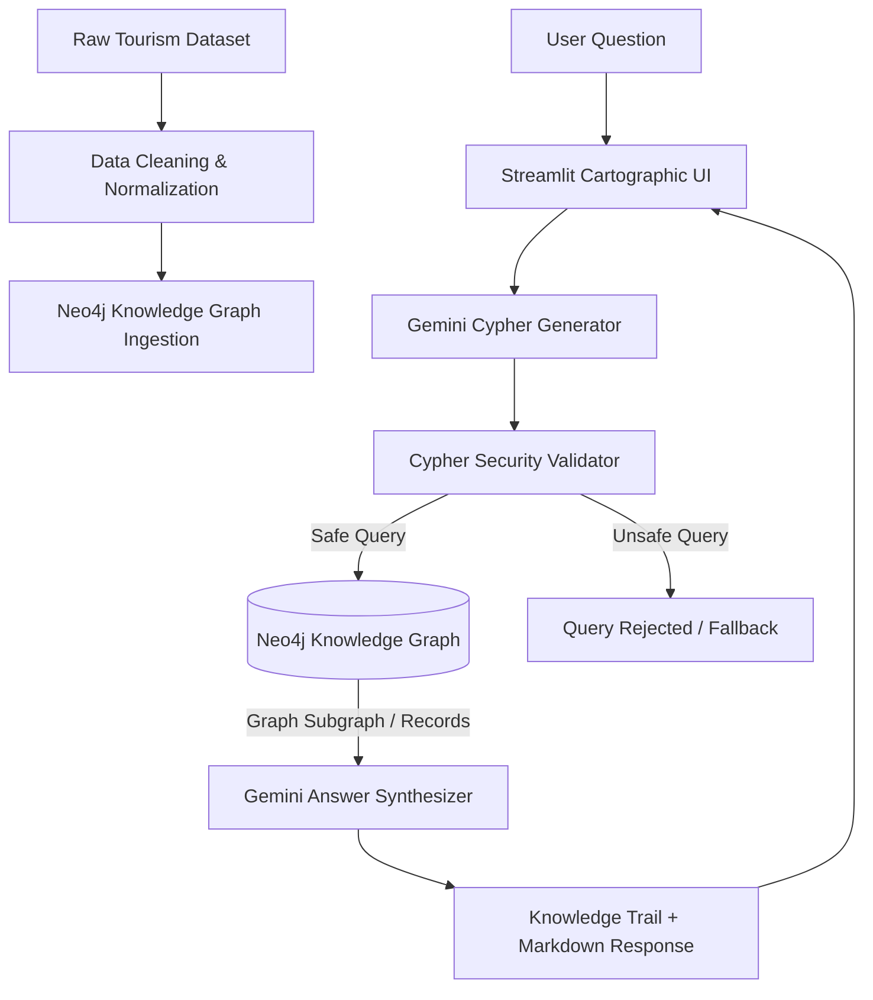

# 🗺️ Bharat Atlas — India Tourism Graph RAG

> **A Knowledge-Graph Powered Retrieval-Augmented Generation (Graph RAG) Engine for Exploring Indian Tourism**

Bharat Atlas is an intelligent travel exploration and decision-support system built on a **Neo4j Knowledge Graph** and powered by **Google Gemini LLMs**. It transforms natural language inquiries into precise graph queries (Cypher), retrieves deterministic relational data across Indian destinations, and synthesizes structured travel recommendations.

---

## 📑 Table of Contents
1. [What is Bharat Atlas?](#-what-is-bharat-atlas)
2. [What is it Used For? (Use Cases)](#-what-is-it-used-for)
3. [Why Graph RAG? (Comparison with Other Approaches)](#-why-graph-rag-vs-other-approaches)
4. [What Technologies is it Using?](#-tech-stack--tools)
5. [How Was it Built? (System Architecture & Pipeline)](#-how-it-was-built)
6. [Knowledge Graph Schema & Data Model](#-knowledge-graph-schema)
7. [Installation & Setup](#-installation--setup)
8. [Project Structure](#-project-structure)

---

## 🧭 What is Bharat Atlas?

Traditional travel chatbots either rely on generic LLM memory (prone to hallucinations and outdated facts) or standard vector search (which struggles with strict relational constraints like *"Find high-altitude destinations in Northern India safe for solo female travelers during winter"*).

**Bharat Atlas** solves this by structuring India's rich tourism ecosystem into an interconnected **Graph Database (Neo4j)**. When a user asks a question, the system:
1. Understands user intent and translates it into an optimized **Cypher** query.
2. Validates the query for safety (read-only enforcement).
3. Executes multi-hop graph traversals across destinations, states, activities, seasons, cuisines, and safety ratings.
4. Generates an evidence-grounded, contextual answer accompanied by an interactive **Knowledge Trail**.

---

## 🎯 What is it Used For?

Bharat Atlas is designed for travelers, travel planners, and tourism researchers who require precise, relational travel intelligence:

- **Complex Multi-Criteria Planning**: Querying by overlapping constraints: *“Find romantic beach destinations in South India with good seafood and high safety ratings.”*
- **Seasonal & Climate Advisory**: Determining the optimal or discouraged seasons for travel: *“Where should I go in July to avoid monsoon landslides?”*
- **Traveler-Specific Recommendations**: Tailoring recommendations for solo travelers, families, budget backpackers, or adventure seekers.
- **Logistical & Connectivity Intelligence**: Checking road connectivity, altitude, nearest airports/railways, permit requirements, and ATM/mobile network availability.
- **Cultural & Gastronomic Discovery**: Uncovering local customs, cultural etiquettes, and signature regional dishes.

---

## ⚖️ Why Graph RAG vs Other Approaches?

| Feature / Dimension | Standard LLM (Zero-Shot) | Vector RAG (Embeddings / Vector DB) | SQL / Relational DB RAG | **Graph RAG (Bharat Atlas)** |
| :--- | :--- | :--- | :--- | :--- |
| **Data Grounding** | ❌ Prone to hallucinations | ⚠️ Unstructured text chunks | ✅ Strict tabular records | 🌟 **Interconnected Knowledge Graph** |
| **Multi-Hop Traversal** | ❌ Cannot guarantee facts | ❌ Poor (Cannot connect multi-step links) | ⚠️ Complex multi-table JOINs | 🌟 **Native multi-hop graph traversal** |
| **Multi-Criteria Filtering** | ⚠️ Partial / Inaccurate | ❌ Embedding similarity blurs strict filters | ✅ Good at filtering | 🌟 **Exact entity filtering + attribute matching** |
| **Hallucination Prevention** | ❌ High hallucination rate | ⚠️ Moderate (context leakage) | ✅ Low (if SQL succeeds) | 🌟 **Zero-hallucination factual grounding** |
| **Explainability** | ❌ Black box | ⚠️ Semantic chunk matching | ✅ SQL query visibility | 🌟 **Transparent Cypher path & visual Knowledge Trail** |
| **Relationship Modeling** | ❌ Implicit only | ❌ Ignores structured relations | ⚠️ Foreign keys rigid | 🌟 **First-class nodes & semantic edges** |

### Why Not Just Vector RAG?
In a standard Vector RAG setup, documents are split into chunks and indexed via vector embeddings. If you ask:
> *"Show me adventure destinations in Himachal Pradesh suitable for solo travelers in summer with high safety."*

Vector embeddings match chunks that contain words like "Himachal", "adventure", and "summer". However:
- It cannot perform deterministic set intersections across 5 distinct entities (State + Activity + Traveler Type + Season + Safety Score).
- It cannot traverse relationships (e.g., Destination $\rightarrow$ In District $\rightarrow$ In State $\rightarrow$ Has Activity $\rightarrow$ Best In Season).
- **Graph RAG guarantees 100% precision** by executing a graph traversal query directly on the schema.

---

## 🛠️ Tech Stack & Tools

| Component | Technology | Role & Purpose |
| :--- | :--- | :--- |
| **Graph Database** | **Neo4j Aura / Desktop** | Native graph store holding destinations, entities, and relationships |
| **Query Language** | **Cypher** | Declarative graph query language for multi-hop graph search |
| **LLM & Orchestration** | **Google Gemini (`google-genai` SDK)** | Converts natural language $\rightarrow$ Cypher and synthesizes final insights |
| **Models Supported** | `gemini-3.5-flash-lite`, `gemini-3.8-flash`, `gemini-3.7-flash` | High-speed, low-latency reasoning with automatic model failover |
| **Frontend UI** | **Streamlit** | Custom cartographic digital atlas interface with visual graph trails |
| **Data Pipeline** | **Python & Pandas** | Cleaning, schema validation, and bulk ingestion into Neo4j |
| **Environment** | **Python 3.10+ / `python-dotenv`** | Secure credential management and system orchestration |

---

## 🏗️ How It Was Built



### Pipeline Steps:
1. **Dataset Ingestion & Graph Modeling (`src/build_graph.py`)**:
   - Ingests structured Indian tourism records.
   - Creates uniqueness constraints and indexes on nodes (`Destination`, `State`, `Activity`, etc.).
   - Establishes semantic directed edges connecting destinations to geographical and experiential entities.
2. **Natural Language to Cypher Translation (`src/cypher_generator.py`)**:
   - Injects graph ontology into the system prompt.
   - Instructs Gemini to generate read-only Cypher queries using case-insensitive filters and ranking logic.
   - Implements multi-model fallback to handle API availability gracefully.
3. **Query Safety Validation (`src/cypher_validator.py`)**:
   - Enforces read-only operations by blocking destructive keywords (`CREATE`, `DELETE`, `MERGE`, `DROP`, `SET`).
4. **Graph Retrieval (`src/graph_retriever.py`)**:
   - Executes Cypher against Neo4j and extracts structured tabular/JSON subgraphs.
5. **Answer Synthesis (`src/answer_generator.py`)**:
   - Grounded LLM response generation incorporating safety ratings, logistics, ideal duration, and cultural notes.
6. **Cartographic Exploration Frontend (`app.py`)**:
   - Custom Streamlit web interface designed as a digital atlas with a visual **Knowledge Trail** showing the exact entities traversed in the graph.

---

## 📊 Knowledge Graph Schema

### Node Types
- `(:Destination)`: Core tourism location with properties (coordinates, altitude, safety score, popularity, ideal days, road/mobile connectivity, permits).
- `(:State)`: Indian states / union territories (`name`).
- `(:District)`: District administrative division (`name`).
- `(:Region)`: Broader geographic zone (North, South, East, West, North-East, Central).
- `(:Activity)`: Available experiences (e.g., Trekking, Scuba Diving, Temple Tour, Skiing).
- `(:Attraction)`: Key landmarks, monuments, viewpoints, or beaches.
- `(:TripType)`: Experience style (e.g., Adventure, Heritage, Nature, Relaxation).
- `(:TravelerType)`: Audience fit (e.g., Solo, Family, Couples, Friends).
- `(:Cuisine)`: Must-try regional delicacies and culinary specialties.
- `(:Season)`: Best / Avoid travel seasons (e.g., Winter, Summer, Monsoon).

### Relationships
```cypher
(:Destination)-[:IN_STATE]->(:State)
(:Destination)-[:IN_DISTRICT]->(:District)
(:Destination)-[:IN_REGION]->(:Region)
(:Destination)-[:HAS_ACTIVITY]->(:Activity)
(:Destination)-[:HAS_ATTRACTION]->(:Attraction)
(:Destination)-[:HAS_TRIP_TYPE]->(:TripType)
(:Destination)-[:SUITABLE_FOR]->(:TravelerType)
(:Destination)-[:HAS_CUISINE]->(:Cuisine)
(:Destination)-[:BEST_IN]->(:Season)
(:Destination)-[:AVOID_IN]->(:Season)
```

---

## 🚀 Installation & Setup

### 1. Prerequisites
- Python 3.10+
- A running Neo4j instance (Neo4j Desktop, Docker, or Neo4j AuraDB)
- A Google Gemini API Key

### 2. Clone & Install Dependencies
```bash
git clone https://github.com/your-repo/india-travel-graph-rag.git
cd india-travel-graph-rag
pip install -r requirements.txt
```

### 3. Configure Environment
Create a `.env` file in the project root:
```env
NEO4J_URI=neo4j+s://your-instance.databases.neo4j.io
NEO4J_USERNAME=neo4j
NEO4J_PASSWORD=your-neo4j-password
GEMINI_API_KEY=your-gemini-api-key
```

### 4. Populate Knowledge Graph
```bash
python src/build_graph.py
```

### 5. Launch the Web Application
```bash
python -m streamlit run app.py
```
Open `http://localhost:8501` in your browser.

---

## 📁 Project Structure

```text
india-travel-graph-rag/
├── data/
│   └── indian_tourism.json         # Raw & structured tourism dataset
├── src/
│   ├── build_graph.py              # Ingests data and constructs Neo4j graph
│   ├── clean_data.py               # Data cleaning and normalization utilities
│   ├── config.py                   # Environment configuration & credential loader
│   ├── cypher_generator.py         # LLM Cypher generation with model fallback
│   ├── cypher_validator.py         # Security validation for Cypher queries
│   ├── graph_retriever.py          # Neo4j query execution engine
│   ├── answer_generator.py         # Evidence-based LLM answer synthesis
│   ├── graph_rag.py                # End-to-end Graph RAG orchestration pipeline
│   ├── graph_queries.py            # Predefined Cypher queries for benchmark testing
│   └── neo4j_connection.py        # Neo4j database driver connection manager
├── app.py                          # Streamlit Cartographic Travel Atlas Web UI
├── test_graph_rag.py               # CLI testing script for Graph RAG pipeline
├── requirements.txt                # Python package dependencies
├── README.md                       # Comprehensive project documentation
└── ARCHITECTURE.md                 # Deep-dive architectural & Graph RAG comparison
```
